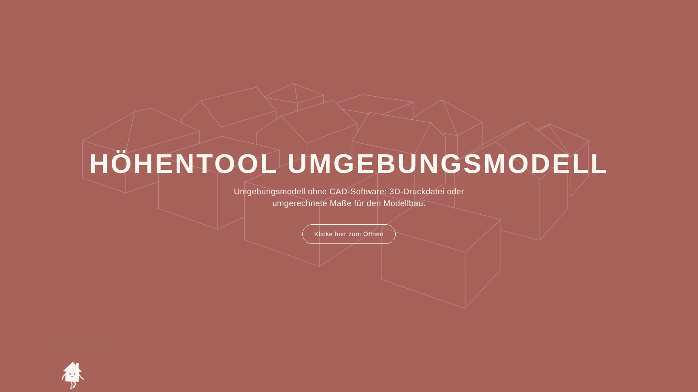
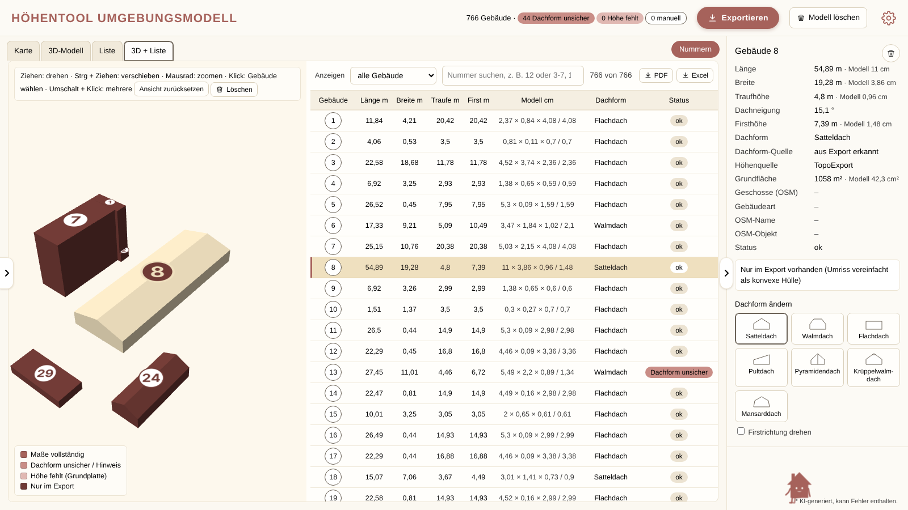
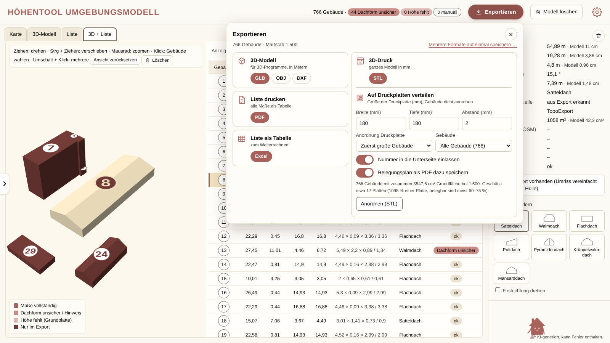

# Höhentool Umgebungsmodell

**Umgebungsmodell ohne CAD-Software: 3D-Druckdatei oder umgerechnete Maße für den Modellbau.**

**Live-Demo:** https://jade-hs-vibecoding-wpk.github.io/gebaeudehoehentool-umgebungsmodell/



## Was ist das Tool?

Das Höhentool ist eine Web-App für Architekturstudierende, die ein Umgebungsmodell bauen wollen. Man lädt den 3D-Export eines Stadtausschnitts, zum Beispiel von TopoExport. Das Tool erkennt darin jedes Gebäude und ermittelt:

- Länge und Breite;
- Trauf- und Firsthöhe;
- Dachneigung und Dachform.

Alle Maße rechnet es in den gewünschten Maßstab um, zum Beispiel 1:500. Für den 3D-Druck verteilt es die Gebäude platzsparend auf Druckplatten. Die Ergebnisse lassen sich so ausgeben:

- 3D-Modell: GLB, OBJ, DXF
- 3D-Druck: STL, auf Wunsch mit eingelassenen Nummern und einem Belegungsplan als PDF
- Gebäudeliste: PDF, Excel



*Hauptfunktion: Gebäude 8 ist ausgewählt. Links im 3D-Modell, in der Mitte in der Liste, rechts mit allen Maßen in Metern und im Modellmaß.*



*Export: 3D-Modell, Liste und 3D-Druck mit Einstellungen für die Druckplatten.*

## Installation und Start

Es muss nichts installiert werden. Die ganze App ist eine einzige Datei (`index.html`). Sie läuft in jedem aktuellen Browser (Chrome, Edge, Firefox, Safari) und braucht keinen Server.

**Variante 1: Live-Demo (empfohlen)**
Die Live-Demo öffnen und auf **„Klicke hier zum Öffnen“** klicken.

**Variante 2: lokal**
1. Das Repository herunterladen: auf GitHub **Code → Download ZIP**, oder
   ```bash
   git clone https://github.com/Jade-HS-Vibecoding-WPK/gebaeudehoehentool-umgebungsmodell.git
   ```
2. Die Datei `index.html` doppelklicken. Sie öffnet sich im Browser und läuft auch ohne Internet.

**Erste Schritte**
1. Eine 3D-Datei (OBJ, DXF oder STL) auf das Feld **„Datei hierher ziehen“** ziehen.
   Ohne eigene Datei: **Testversion → Beispieldaten ausprobieren**. Das lädt einen Ausschnitt aus Wilhelmshaven.
2. Links unter **Maßstab** den Maßstab eintragen, z. B. `500`.
3. Gebäude anklicken und die Maße ablesen. Unsichere Dachformen lassen sich rechts korrigieren.
4. Oben rechts auf **Exportieren** klicken.

Nach einem Update die Seite einmal mit `?neu=1` am Ende der Adresse öffnen, damit der Browser keine alte, gespeicherte Fassung zeigt.

## Aufbau des Repositorys

| Pfad | Inhalt |
|---|---|
| `index.html` | die Web-App (wird über GitHub Pages veröffentlicht) |
| `docs/screenshots/` | Screenshots für diese README |
| `src/`, `config/`, `tests/`, `viewer/`, `webapp/` | frühere Python- und JavaScript-Fassung des Projekts (Daten aus OpenStreetMap) |

## Datenquellen und Lizenzen

| Quelle | Wofür | Lizenz / Nutzungsbedingungen |
|---|---|---|
| [TopoExport](https://topoexport.com/) | Hauptquelle: 3D-Exporte (DXF, OBJ, STL) mit Gebäuden und Dachflächen, auch die Testversion Wilhelmshaven | Nutzungsbedingungen von TopoExport. TopoExport bereitet offene Geodaten auf; es gilt die Lizenz der jeweiligen Ursprungsdaten (siehe nächste Zeile). |
| [LGLN, 3D-Gebäudemodelle LoD2](https://opengeodata.lgln.niedersachsen.de/) | Ursprungsdaten der Gebäude in Niedersachsen (Testversion Wilhelmshaven) | [CC BY 4.0](https://creativecommons.org/licenses/by/4.0/deed.de). Quellenvermerk: „LGLN (Jahr des Datenbezugs)“ |
| [OpenStreetMap](https://www.openstreetmap.org/copyright) | optional: Grundrisse, Gebäudeart, Geschosszahl, Höhe und Dachform, wenn eine OSM-Datei geladen wird; frühere Python-Fassung | [ODbL 1.0](https://opendatacommons.org/licenses/odbl/). Quellenvermerk: „© OpenStreetMap-Mitwirkende“ |

Der Programmcode steht unter der **MIT-Lizenz**, siehe [`LICENSE`](LICENSE).

## KI-Nutzung

Dieses Projekt wurde mit KI erstellt:

- **Code und Gestaltung:** Der Code der Web-App wurde mit **Claude (Anthropic)** geschrieben, auf Grundlage der Vorgaben und Rückmeldungen des Teams. Das Team hat die Ergebnisse geprüft, getestet und über die Gestaltung entschieden.
- **README und Screenshots:** Diese README und die Screenshots wurden ebenfalls mit Claude erstellt. Die Screenshots sind automatisch aus der App aufgenommen.
- **Hinweis in der App:** Die App zeigt den Hinweis „* KI-generiert, kann Fehler enthalten.“

Bitte wichtige Maße vor dem Modellbau prüfen.

## Projekt

Studentisches Projekt im Wahlpflichtkurs **„Vibecoding“** an der **Jade Hochschule** (Wintersemester 2026/27) von Nele Geerdsen und Miriam Lorch.
